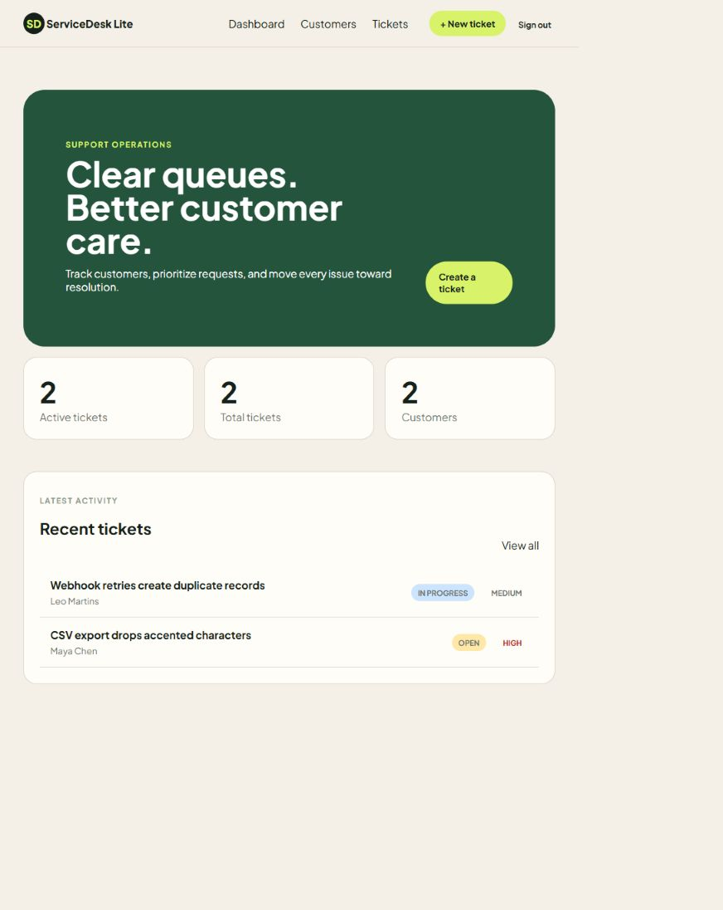
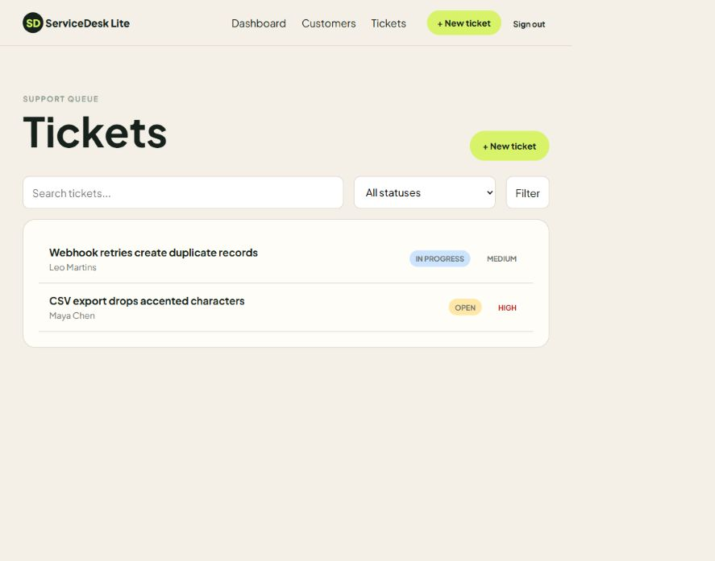
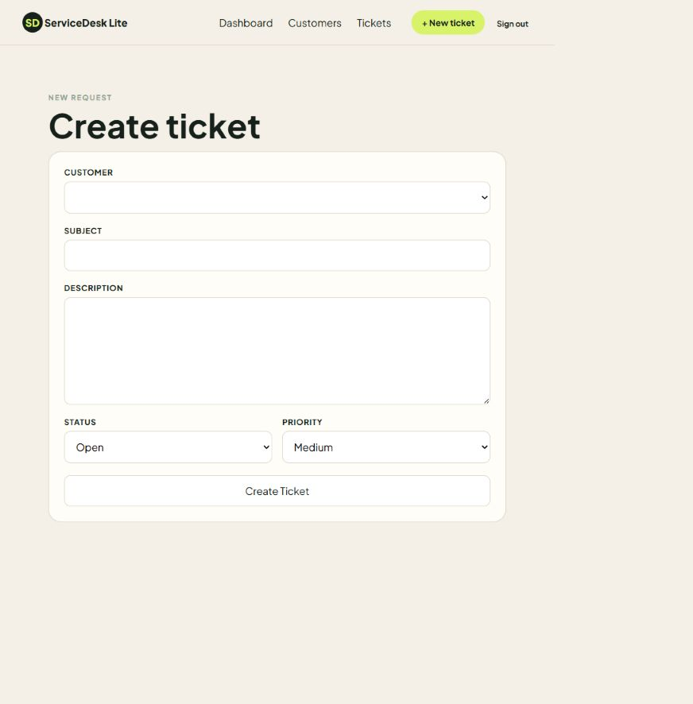

# ServiceDesk Lite

ServiceDesk Lite is a focused Ruby on Rails help-desk workspace for small support teams. It turns customer requests into a clear, searchable queue so work can be prioritized and moved toward resolution.

## What it demonstrates

- Dashboard metrics for customers, total tickets, and active tickets
- Customer and ticket CRUD workflows
- Ticket status and priority tracking
- Search and status filtering for support queues
- Secure demo login with password hashing and protected pages
- Multi-workspace data isolation for SaaS-style accounts
- Role-based access for administrators, agents, and read-only viewers
- Immutable-style audit records for customer and ticket changes
- Versioned JSON REST API with bearer-token authentication
- Responsive interface for desktop and mobile

## Technology

Ruby 3.4 · Rails 8.1 · SQLite · Hotwire · Propshaft · bcrypt · Minitest

## Run locally

```bash
bundle install
bin/rails db:prepare
bin/rails db:seed
bin/rails server
```

Open `http://127.0.0.1:3000` and use the demo account:

`demo@servicedesk.test` / `demo1234`

## Tests and quality

```bash
bin/rails test
bin/rubocop
```

The test suite covers authentication, access protection, dashboard rendering, customer CRUD, ticket CRUD, search, and filtering.

## REST API

The versioned API uses a bearer token and applies the same workspace isolation and role rules as the web interface.

```bash
curl http://localhost:3000/api/v1/tickets \
  -H "Authorization: Bearer demo-api-token"
```

Supported endpoints: `GET /api/v1/tickets`, `GET /api/v1/tickets/:id`, `POST /api/v1/tickets`, and `PATCH /api/v1/tickets/:id`.

## Portfolio context

This project is intentionally small enough to understand quickly and realistic enough to discuss with a client: a support team can see operational metrics, find a request, update its status, and maintain customer context in one place.

## Screenshots

### Dashboard



### Ticket queue



### New ticket form


